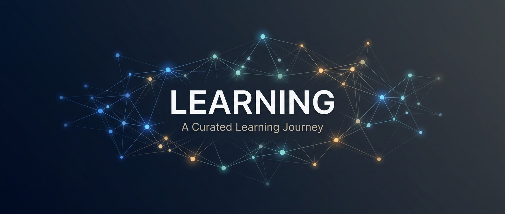

<p align="center">
  
</p>

<h3 align="center">Curated, structured curricula for self-directed mastery</h3>

<p align="center">
  <a href="ml/">🧠 Machine Learning</a> •
  <a href="math/">🔢 Mathematics</a> •
  <a href="physics/">⚛️ Physics</a> •
  <a href="bio/">🧬 Biology</a> •
  <a href="econ/">📈 Economics</a> •
  <a href="philosophy/">🧠 Philosophy</a> •
  <a href="pcb/">🔌 PCB Design</a> •
  <a href="btc/">₿ Bitcoin</a> •
  <a href="software/">🏗️ Software Engineering</a>
</p>

---

## What Is This?

A personal knowledge repository containing **nine structured learning curricula** — each with curated resources, ordered sections, and progress tracking. Built for deep, self-directed study paired with [NotebookLM](https://notebooklm.google.com/).

Every curriculum follows the same structure:
- **12+ numbered sections** progressing from foundations to frontiers
- **Must-read markers** (🔑) highlighting absolute priorities
- **Cross-cutting references** (books, courses, blogs/tools)
- **Progress tracker** (`PROGRESS.md`) for checking off items
- **Agent skill** (`.agents/skills/update-curriculum`) for keeping content current

---

## 📚 The Curricula

### [🧠 Machine Learning](ml/)
> From the roots of AI to the latest frontiers — a complete path through modern ML.

| Highlights | |
|---|---|
| **Sections** | Historical foundations → Math → Classical ML → Neural nets → CNNs/ViTs → RNNs → Transformers → Generative models → Scaling/Efficiency → LLMs → RL → Frontiers → **Interpretability & Alignment** → **Graphs, Geometry & Science** |
| **Special marker** | ⭐ = Ilya Sutskever's reading list ("*If you really learn all of these, you'll know 90% of what matters today*") |
| **Key resources** | Karpathy, 3Blue1Brown, Andrew Ng, Stanford CS courses, Goodfellow, Sutton & Barto, Anthropic (mechanistic interpretability) |

---

### [🔢 Mathematics](math/)
> From foundational reasoning to the mathematical machinery powering modern AI and science.

| Highlights | |
|---|---|
| **Sections** | Mathematical thinking → Linear algebra → Analysis → Probability → Optimization → Information theory → Graph theory → Differential equations → Abstract algebra → Topology/geometry → Causal inference → Category theory |
| **Key resources** | Axler, Strang, Abbott, Boyd & Vandenberghe, Cover & Thomas, Pearl, Strogatz, 3Blue1Brown |
| **Focus** | Genuine mathematical maturity, not just "math for ML" |

---

### [⚛️ Physics](physics/)
> From classical mechanics to quantum computing — the physical principles underlying simulation, modeling, and AI for science.

| Highlights | |
|---|---|
| **Sections** | Classical mechanics → Waves/optics → Thermodynamics → Electromagnetism → Quantum mechanics → Relativity → Computational physics → Quantum computing → Condensed matter → Fluids → Chaos → Physics-informed ML |
| **Key resources** | Feynman Lectures, Griffiths, Schroeder, Strogatz, Newman, Nielsen & Chuang, Qiskit |
| **Focus** | Physics that connects to computation, simulation, and AI applications |

---

### [🧬 Biology & Computational Life Sciences](bio/)
> From molecular biology fundamentals to AI-driven drug discovery and protein design.

| Highlights | |
|---|---|
| **Sections** | Molecular biology → Biochemistry → Genetics/genomics → Structural biology → Bioinformatics → Systems biology → Drug discovery → Protein design → Genomic medicine → Neuroscience → AI for biology → Frontiers |
| **Key resources** | Alberts, Lehninger, Durbin, Dayan & Abbott, AlphaFold, RFdiffusion, ESM-2 |
| **Focus** | The conceptual foundation for AI × life sciences innovation |

---

### [📈 Economics, Decision Theory & Game Theory](econ/)
> The mathematics of incentives, strategy, and coordination.

| Highlights | |
|---|---|
| **Sections** | Economic thinking → Microeconomics → Game theory → Decision theory → Mechanism design → Information economics → Behavioral economics → Network economics → Computational economics → Social choice → Monetary/crypto → AI alignment economics |
| **Key resources** | Varian, Tadelis, Kahneman, Börgers, Easley & Kleinberg, Nisan et al., Roughgarden |
| **Focus** | Foundations for AI alignment, multi-agent systems, and incentive design |

---

### [🧠 Philosophy of Mind & Intelligence](philosophy/)
> The deepest questions about minds, machines, consciousness, and what it means to understand.

| Highlights | |
|---|---|
| **Sections** | Foundations → Philosophy of mind → Consciousness → Computation & mind → Intelligence → Philosophy of AI → Ethics of AI → Existential risk → Language & meaning → Free will → Eastern philosophy → Frontiers |
| **Key resources** | Hofstadter (GEB), Chalmers, Dennett, Bostrom, Russell, Kim, Searle, Turing |
| **Focus** | What intelligence actually *is* — the questions that shape how you build AI |

---

### [🔌 PCB Design](pcb/)
> From electronics fundamentals to high-speed signal integrity and EMC compliance.

| Highlights | |
|---|---|
| **Sections** | Electronics → PCB anatomy → Schematic → Components → Layout → Power/grounding → Signal integrity → EMC → Stackup → DFM → Advanced → Reference projects |
| **Special marker** | ⭐ = Rick Hartley's recommended reading list |
| **Key resources** | Phil's Lab, Robert Feranec, Rick Hartley, Bogatin, Johnson & Graham, Ott |
| **Included docs** | IPC-2221, PCB Design Tutorial, Rick's Reading Recommendations (PDFs) |

---

### [₿ Bitcoin](btc/)
> From the cypherpunk manifesto to Taproot — a deep technical understanding of Bitcoin.

| Highlights | |
|---|---|
| **Sections** | History/philosophy → Cryptography → Protocol → Mining → Transactions/Script → Wallets/BIPs → P2P network → Lightning → Security/privacy → Economics → Development → Frontiers |
| **Special marker** | ⭐ = Satoshi/Cypherpunk canon |
| **Key resources** | Mastering Bitcoin (Antonopoulos), Programming Bitcoin (Song), Learn Me A Bitcoin, Lopp.net, Chaincode Labs, 3Blue1Brown |

---

### [🏗️ Software Engineering](software/)
> Mastering code in the age of AI — focused on reading, reviewing, and architecting, not typing line by line.

| Highlights | |
|---|---|
| **Sections** | CS foundations → Python → Embedded C → Code reading/review → Architecture → Testing → Systems → RTOS → Security → **Agentic AI workflows** → Version control → Professional practice |
| **Special marker** | 🤖 = AI-workflow specific resources |
| **Key resources** | Fluent Python, K&R C, DDIA, Refactoring, Code Reading, Quantum Leaps, Simon Willison, Embedded Artistry |
| **Focus** | Python + Embedded C · Senior architect mindset · Human-in-the-loop AI development |

---

## 🗂️ Repository Structure

```
learning/
├── README.md              ← you are here
├── assets/
│   └── banner.jpg
├── ml/                    ← Machine Learning curriculum
│   ├── README.md
│   ├── PROGRESS.md
│   ├── 00-historical-foundations/
│   ├── ...
│   ├── 13-graphs-geometry-and-science/
│   ├── books/
│   ├── courses/
│   └── blogs-and-references/
├── math/                  ← Mathematics curriculum
│   ├── README.md
│   ├── PROGRESS.md
│   ├── 00-mathematical-thinking/
│   ├── ...
│   ├── 11-category-theory-and-frontiers/
│   ├── books/
│   ├── courses/
│   └── blogs-and-references/
├── physics/               ← Physics curriculum
│   ├── README.md
│   ├── PROGRESS.md
│   ├── 00-classical-mechanics/
│   ├── ...
│   ├── 11-physics-informed-ml-and-frontiers/
│   ├── books/
│   ├── courses/
│   └── blogs-and-references/
├── bio/                   ← Biology curriculum
│   ├── README.md
│   ├── PROGRESS.md
│   ├── 00-molecular-biology-fundamentals/
│   ├── ...
│   ├── 11-frontiers/
│   ├── books/
│   ├── courses/
│   └── blogs-and-references/
├── econ/                  ← Economics curriculum
│   ├── README.md
│   ├── PROGRESS.md
│   ├── 00-economic-thinking/
│   ├── ...
│   ├── 11-ai-alignment-economics-and-frontiers/
│   ├── books/
│   ├── courses/
│   └── blogs-and-references/
├── philosophy/            ← Philosophy curriculum
│   ├── README.md
│   ├── PROGRESS.md
│   ├── 00-foundations-of-philosophy/
│   ├── ...
│   ├── 11-frontiers/
│   ├── books/
│   ├── courses/
│   └── blogs-and-references/
├── pcb/                   ← PCB Design curriculum
│   ├── README.md
│   ├── PROGRESS.md
│   ├── 00-electronics-fundamentals/
│   ├── ...
│   ├── 11-reference-projects/
│   ├── books/
│   ├── courses/
│   ├── blogs-and-references/
│   └── documents/         (IPC-2221, tutorials, PDFs)
├── btc/                   ← Bitcoin curriculum
│   ├── README.md
│   ├── PROGRESS.md
│   ├── 00-history-and-philosophy/
│   ├── ...
│   ├── 11-advanced-and-frontiers/
│   ├── books/
│   ├── courses/
│   └── blogs-and-references/
└── software/              ← Software Engineering curriculum
    ├── README.md
    ├── PROGRESS.md
    ├── 00-cs-foundations/
    ├── ...
    ├── 11-professional-practice/
    ├── books/
    ├── courses/
    └── blogs-and-references/
```

---

## How to Use

1. **Pick a curriculum** and open its `README.md` for the full learning path
2. **Work through sections in order** — each has curated resources with 🔑 must-reads
3. **Track progress** in `PROGRESS.md` — check off items as you go
4. **Pair with NotebookLM** — upload sections or book chapters for interactive study
5. **Keep current** — use the `update-curriculum` agent skill to add new resources

---

## License

Personal learning repository. All linked resources belong to their respective authors and publishers.
