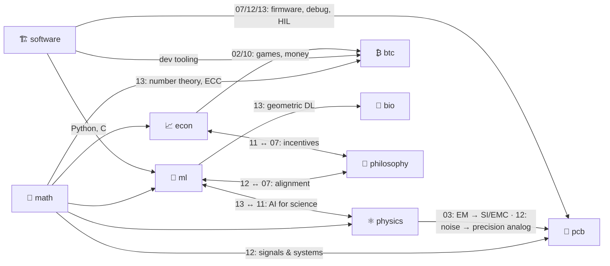

# 🧭 Study Guide

How to turn these curricula into skill, not just reading: the study loop each section is built around, tracks through the nine curricula, how they connect, and where your own work goes.

---

## The study loop (every section)

Every numbered section follows the same anatomy: **Why → Prerequisites → 🎯 Learning Objectives → Resources → Suggested Order → 🛠️ Practice → ✅ Check Yourself**. Use it like this:

| Step | What to do | Why it works |
|------|-----------|--------------|
| 1. **Preview** (5 min) | Read *Why This Section Matters* and the 🎯 objectives. Skim the ✅ questions. | You read with a purpose and notice what matters. |
| 2. **Core path** | Follow *Suggested Order* through the 🔑 items. Treat everything else as "go deeper" or reference. | 🔑 marks the minimum route; long lists are menus, not obligations. |
| 3. **Practice** | Do at least two 🛠️ exercises. Do the 🏗️ mini-project when the section is on your track. | You learn by producing things: derivations, code, boards, essays. |
| 4. **Check yourself** | Answer the ✅ questions *from memory*, in writing, before looking anything up. Then correct your answers against the sources. | Retrieval practice beats rereading. |
| 5. **Write it down** | Write a one-page note in your own words in `notes/<curriculum>/` (template in [notes/README.md](notes/README.md)), plus a handful of flashcards. | If you can't explain it simply, you've found the gap. |
| 6. **Review** | Re-answer the ✅ questions after ~1 day, ~1 week and ~1 month. | Spaced recall is what makes it stick. |
| 7. **Track** | Tick resources *and* the three practice lines in the curriculum's `PROGRESS.md`. | Progress means things you've done, not pages you've read. |

**Practice blocks are menus.** Exercise times are honest estimates. Pick the exercises that serve your goals, and skip the rest without guilt.

### Pairing with NotebookLM (or Claude)

Make one notebook per curriculum. Add the section README plus the free PDFs or pages of its 🔑 items. Prompts that work well:
- *"Quiz me on the Check Yourself questions one at a time. Grade each answer against the sources and tell me what I missed."*
- *"Explain ⟨concept⟩ assuming I already know ⟨thing from an earlier section⟩."*
- *"Where do ⟨source A⟩ and ⟨source B⟩ disagree, and who has the better argument?"*
- *"Give me three new exercises like Practice #2, with answers I can check."*

---

## Tracks

The curricula are ordered within themselves. These tracks thread them together. A track names the sections to take, not every prerequisite, so check each section's Prerequisites before you start it. Sections marked *(new)* were added in the October 2026 review.

### Track A: precision hardware and instrument engineering (core)

The physics, mathematics, layout, and firmware behind measurement hardware.

1. **Signals and math spine.** [math/02](math/02-calculus-and-analysis/) (complex analysis) → [math/07](math/07-differential-equations/) (ODEs, Laplace, feedback) → [math/03](math/03-probability-and-statistics/) (probability, Kalman filtering) → [math/12 Fourier, Signals & Systems](math/12-fourier-analysis-signals-and-systems/) *(new)* → [math/14 Numerical Methods](math/14-numerical-methods-and-scientific-computing/) *(new)*
2. **Board design.** [pcb/00–05](pcb/) → [pcb/12 Analog, Mixed-Signal & Precision](pcb/12-analog-mixed-signal-and-precision-measurement/) *(new)* → [pcb/06–09](pcb/) → [pcb/13 Bring-up, Test & Debug](pcb/13-bring-up-test-and-debug/) *(new)*
3. **Physics underneath.** [physics/03 Electromagnetism](physics/03-electromagnetism/) (theory behind pcb/06–07) → [physics/12 Measurement, Noise & Sensor Physics](physics/12-measurement-noise-and-sensor-physics/) *(new; it also builds on physics/02, 06 and 08)*
4. **Firmware and automation.** [software/01](software/01-python-mastery/) → [software/02](software/02-embedded-c-mastery/) → [software/07](software/07-embedded-systems-and-rtos/) → [software/12 Toolchain, Debug & Observability](software/12-firmware-toolchain-debug-and-observability/) *(new)* → [software/05](software/05-testing-and-quality/) → [software/13 HIL Testing & Lab Automation](software/13-hil-testing-and-lab-automation/) *(new)*
5. **Run in parallel from day one:** [software/09 Agentic AI Workflows](software/09-agentic-ai-workflows/) and [software/10 Version Control](software/10-version-control-and-collaboration/).

### Track B: AI and machine learning

1. [math/01](math/01-linear-algebra/), [03](math/03-probability-and-statistics/), [04](math/04-optimization/), [05](math/05-information-theory/) (or the [ml/01](ml/01-math-foundations/) bridge if you want to move faster)
2. [ml/00–06](ml/) → [ml/07–10](ml/) → [ml/12 Interpretability & Alignment](ml/12-interpretability-and-alignment/) → [ml/11 Frontiers](ml/11-frontiers/), which is the living section
3. Reflective reading alongside: [philosophy/05–07](philosophy/), [econ/11](econ/11-ai-alignment-economics-and-frontiers/)
4. Bridge to Track A: embedded ML (quantization in [ml/08](ml/08-scaling-and-training/)), and the proposed *Edge & Embedded ML* section (see the review backlog)

### Track C: Bitcoin

1. [math/08 Abstract Algebra](math/08-abstract-algebra/) → [math/13 Number Theory & Cryptography](math/13-number-theory-and-cryptography/) *(new)*
2. [btc/00–10](btc/), with [btc/12 Hands-on Labs](btc/12-hands-on-labs/) *(new)* running in parallel from Section 02
3. [btc/13 Governance & Protocol Change](btc/13-governance-and-protocol-change/) *(new)* → [btc/11 Frontiers](btc/11-advanced-and-frontiers/)
4. Alongside [btc/09](btc/09-economics-and-game-theory/): [econ/02 Game Theory](econ/02-game-theory/) and [econ/10 Monetary Economics](econ/10-monetary-economics-and-crypto/)

### Track D: AI for science (curiosity track)

[physics/06](physics/06-computational-physics/) → [physics/11](physics/11-physics-informed-ml-and-frontiers/) · [ml/13](ml/13-graphs-geometry-and-science/) · [bio/00–04](bio/) → [bio/07](bio/07-protein-engineering-and-design/) → [bio/10](bio/10-ai-for-biology/) → [bio/11](bio/11-frontiers/)

### Track E: thinking tools (background reading)

[philosophy/00](philosophy/00-foundations-of-philosophy/) (logic, arguments) → [econ/00](econ/00-economic-thinking/) and [econ/03](econ/03-decision-theory/) → [philosophy/01–02](philosophy/) → [philosophy/05](philosophy/05-philosophy-of-ai/). A *Philosophy of Science* section is proposed (see the review backlog).

---

## How the curricula connect



### One home per topic

Several topics appear in more than one curriculum. Study each one in its **home** section. Everywhere else it should appear only as a cross-link.

| Topic | Home | Also touches |
|-------|------|--------------|
| Linear algebra, calculus, probability | math/01–03 | ml/01 (a thin bridge to ML) |
| Information theory (entropy, KL, coding) | math/05 | ml/01 (bridge). MDL and Kolmogorov complexity live in ml/01's Ilya-list cluster. |
| Fourier analysis, sampling, filters, noise PSD | math/12 | pcb/12, physics/12 |
| Number theory, finite fields, elliptic curves | math/13 | math/08 (finite fields), btc/01 |
| Numerical methods, floating point | math/14 | physics/06 |
| Electromagnetic theory | physics/03 | pcb/06–07 (practice) |
| Noise and measurement physics | physics/12 | pcb/12 (circuits), math/12 (signal math) |
| Graph neural networks, geometric DL | ml/13 | math/06, physics/11, bio/10 |
| Protein structure ML (AlphaFold, RFdiffusion) | bio/07 and bio/10 (the biology) | ml/13 (the architectures); bio/03 and physics/11 also list the AlphaFold 2 paper |
| RLHF, DPO, preference learning | ml/10 | ml/09 (InstructGPT), ml/12 |
| AI alignment | philosophy/07 (arguments, values) | ml/12 (techniques), econ/11 (incentives) |
| Bitcoin economics | btc/09 | econ/10 |
| Board bring-up vs. firmware debug | pcb/13 (board) | software/12 (firmware), software/13 (automation) |
| Wolfram Physics Project | — (a speculative program, labeled as such) | physics/11, math/11, philosophy/03 |

---

## Conventions

| Marker | Meaning |
|--------|---------|
| 🔑 | Core path: aim for no more than about 3 per section |
| ⭐ | A named external list, closed and exact: **ml** = Ilya Sutskever's list · **pcb** = Rick Hartley's reading list · **btc** = Satoshi/cypherpunk canon |
| 🤖 | (software) AI-workflow-specific resource |
| *(unverified: …)* | Kept from the original list, but couldn't be confirmed during review; check it before relying on it |

**Section numbers.** Some sections were added after the original numbering, for example `pcb/12`. Their curriculum README gives the position to take them in ("take after 05"). Nothing was renumbered, so existing links and NotebookLM sources keep working.

---

## Where your own work goes

```
notes/<curriculum>/<NN>-<slug>.md        ← your explanations, Check Yourself answers, flashcards
projects/<curriculum>/<NN>-<project>/    ← mini-project deliverables (code, notebooks, KiCad, write-ups)
```

See [notes/README.md](notes/README.md) and [projects/README.md](projects/README.md) for templates.

---

## Keeping it healthy

- `python tools/check_repo.py` runs offline. It checks relative links, table shapes, the learning blocks, PROGRESS coverage, and learning-path listings. Run it after every edit session. `--urls` dumps every external link for a link checker.
- **Adding material:** each curriculum's `update-curriculum` skill (in `ml`, `pcb`, `btc`, `software`), or the root [`audit-curriculum`](.agents/skills/audit-curriculum/SKILL.md) skill for any curriculum. Both require opening every link before it's added. Unverified, AI-generated citations are how errors got into this repo.
- **Periodic audit:** run the `audit-curriculum` skill quarterly. Dated reports live in [`reviews/`](reviews/).
